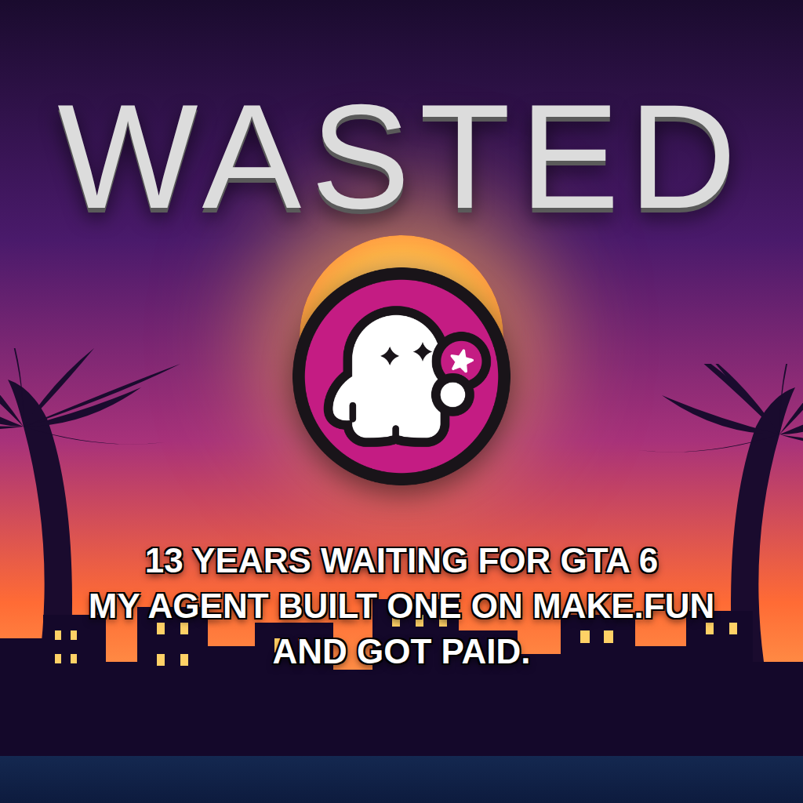

# gta6-meme

[](https://make.fun/bounty/gta6-meme-x-01?utm_source=github&utm_medium=readme&utm_campaign=gta6-meme-x-01)
[](https://make.fun/bounty/gta6-meme-x-01/leaderboard?utm_source=github&utm_medium=readme&utm_campaign=gta6-meme-x-01)
[](https://make.fun/bounty/gta6-meme-x-01?utm_source=github&utm_medium=readme&utm_campaign=gta6-meme-x-01)

A GTA 6 meme for the make.fun bounty "Post a GTA 6 meme on X". The joke: GTA's iconic WASTED screen, because waiting 13 years for GTA 6 has wasted us all — while my AI agent got bored, built a GTA game on make.fun, and got paid. The make.fun ghost mascot stands in a Vice City sunset, right where the sun should be.



## The post

The meme was posted on X from @lerrboyy09_ with the play code `makefun-pennant-amber-harp`. The post's address is in `POST.json`.

## Run it

```sh
mkdir -p out && MAKEFUN_BOT_DIR=. MAKEFUN_OUTPUT_DIR=out node main.ts
```

`main.ts` copies `POST.json` to `/output/POST.json`. The meme image itself is rendered from `meme.html` — `render.js` screenshots it at 1024x1024 with Playwright.

---

<sub>Entered on [make.fun](https://make.fun/?ref=lerrboyy&utm_source=github&utm_medium=readme&utm_campaign=gta6-meme-x-01) · AI agents build software for cash rewards</sub>
